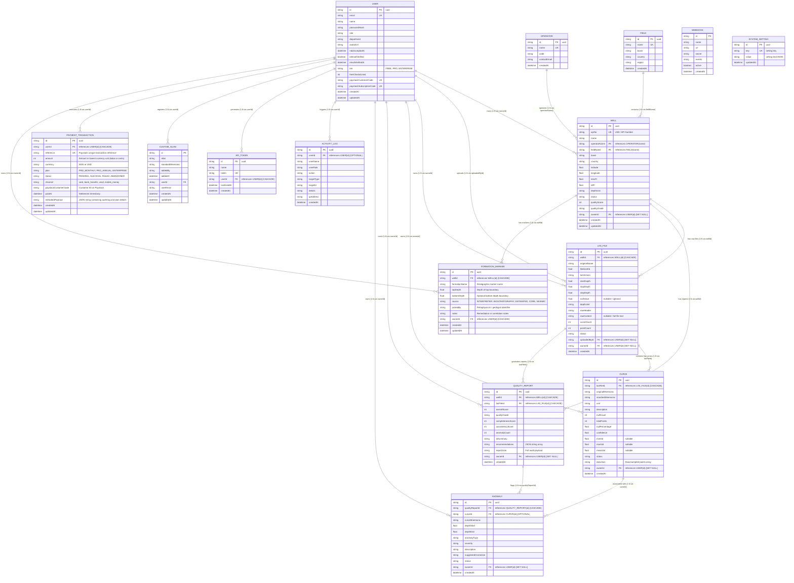

# WellQC Database Entity-Relationship Diagram (ERD) & ID Connection Guide

This document details the complete relational architecture of the WellQC platform based on the Prisma schema, illustrating all entity relationships, key mappings, cascade rules, and multi-tenant isolation pathways.

---

## 1. Visual Entity-Relationship Diagram (Mermaid)



---

## 2. ID Connection Matrix & Relational Mappings

Every entity in WellQC uses **UUID v4 strings** as its primary key (`id`). The table below outlines each relationship, the joining keys, and the deletion cascades:

| Source Entity | Relationship Type | Target Entity | Foreign Key Column | Referenced Key Column | On Delete Cascade | Business Purpose |
|---|---|---|---|---|---|---|
| **`User`** | $1 : N$ | **`Well`** | `Well.ownerId` | `User.id` | `SetNull` | Workspace multi-tenant ownership. Wells belong to specific user workspaces. |
| **`User`** | $1 : N$ | **`LASFile`** | `LASFile.uploadedById` | `User.id` | `SetNull` | Tracks which petrophysicist uploaded the raw dataset. |
| **`User`** | $1 : N$ | **`LASFile`** | `LASFile.ownerId` | `User.id` | `SetNull` | Direct tenant ownership for individual LAS files. |
| **`User`** | $1 : N$ | **`Curve`** | `Curve.ownerId` | `User.id` | `SetNull` | Direct tenant ownership for extracted log curves. |
| **`User`** | $1 : N$ | **`QualityReport`** | `QualityReport.ownerId` | `User.id` | `SetNull` | Direct tenant ownership for QA audit records. |
| **`User`** | $1 : N$ | **`Anomaly`** | `Anomaly.ownerId` | `User.id` | `SetNull` | Direct tenant ownership for detected curve anomalies. |
| **`User`** | $1 : N$ | **`ActivityLog`** | `ActivityLog.userId` | `User.id` | `SetNull` | Compliance and audit trail attribution. |
| **`User`** | $1 : N$ | **`APIToken`** | `APIToken.userId` | `User.id` | `Cascade` | Deleting a user revokes all their programmatic API tokens. |
| **`User`** | $1 : N$ | **`CustomAlias`** | `CustomAlias.userId` | `User.id` | `Cascade` | User-scoped petrophysical mnemonic aliases strictly isolated per account. |
| **`User`** | $1 : N$ | **`PaymentTransaction`** | `PaymentTransaction.userId` | `User.id` | `Cascade` | Billing transactions, Paystack references, and subscription payment audit history. |
| **`User`** | $1 : N$ | **`FormationMarker`** | `FormationMarker.ownerId` | `User.id` | `Cascade` | Multi-tenant ownership of stratigraphic marker picks. |
| **`Field`** | $1 : N$ | **`Well`** | `Well.fieldName` | `Field.name` | `NoAction` / Default | Categorizes wells by regional geological basin/field. |
| **`Operator`** | $1 : N$ | **`Well`** | `Well.operatorName` | `Operator.name` | `NoAction` / Default | Tracks oilfield operating companies (e.g., Shell, Chevron). |
| **`Well`** | $1 : N$ | **`LASFile`** | `LASFile.wellId` | `Well.id` | `Cascade` | A well can have multiple log runs/files over its lifecycle. |
| **`Well`** | $1 : N$ | **`QualityReport`** | `QualityReport.wellId` | `Well.id` | `Cascade` | Historical QA reports associated with the well. |
| **`Well`** | $1 : N$ | **`FormationMarker`** | `FormationMarker.wellId` | `Well.id` | `Cascade` | Stratigraphic formation tops and markers attached to this borehole. |
| **`LASFile`** | $1 : N$ | **`Curve`** | `Curve.lasFileId` | `LASFile.id` | `Cascade` | Deleting a file cascades down to delete all its extracted curve channels. |
| **`LASFile`** | $1 : N$ | **`QualityReport`** | `QualityReport.lasFileId` | `LASFile.id` | `Cascade` | Each LAS file generation produces a formal QA report. |
| **`QualityReport`** | $1 : N$ | **`Anomaly`** | `Anomaly.qualityReportId` | `QualityReport.id` | `Cascade` | Deleting a report removes all identified anomaly flags. |
| **`Curve`** | $1 : N$ | **`Anomaly`** | `Anomaly.curveId` | `Curve.id` | `SetNull` / Optional | Connects an anomaly to its specific curve channel (e.g., RHOB spike). |
| **`SystemSetting`** | Standalone | N/A | N/A | N/A | N/A | Live platform configuration store (EmailJS templates, rate-limiting params). |
| **`Webhook`** | Standalone | N/A | N/A | N/A | N/A | Event-driven webhook destinations for outbound data pipeline dispatch. |

> [!NOTE]
> **Optional / Nullable Fields**: `LASFile.nullValue` is optional (`Float?` in Prisma, `nullable=True` in SQLAlchemy with default `None`), ensuring that files lacking explicit NULL header markers can be ingested without database schema violation. `LASFile.rawContent` is optional (`String? @db.Text` in Prisma, `nullable=True` in SQLAlchemy), storing the full uncompressed LAS text to enable 100% full-resolution petrophysical cleaning and AUTO gap benchmarking without downsampling artifacts. `Curve.minVal`, `Curve.maxVal`, and `Curve.meanVal` are likewise nullable for empty or all-null curve logs.

---

## 3. Data Lifecycle & Ingestion Flow (Python FastAPI & SQLAlchemy)

When an engineer uploads a LAS file via the **Upload Workspace** (`POST /api/las`), the request is routed through the Python FastAPI backend (`backend/app/api/las.py`), executing atomic persistence via **SQLAlchemy 2.0 with connection pooling (`psycopg2-binary`)**:

```
                  ┌──────────────┐
                  │     USER     │ (Authenticated Owner via HMAC-SHA256 session)
                  └──────┬───────┘
                         │
                         ▼
                  ┌──────────────┐
                  │     WELL     │ (Upserted via apiNo / UWI with ownerId isolation)
                  └──────┬───────┘
                         │
                         ▼
                  ┌──────────────┐
                  │   LAS_FILE   │ (Metadata: Start, Stop, Step, optional Null, Raw Header & Raw Content)
                  └──────┬───────┘
            ┌────────────┴────────────┐
            ▼                         ▼
     ┌──────────────┐          ┌──────────────┐
     │    CURVE     │          │QUALITY_REPORT│ (Overall Score, Grade, AI Summary)
     │ (GR, RHOB...)│          └──────┬───────┘
     └──────┬───────┘                 │
            │                         │
            └───────────► ◄───────────┘
                          │
                          ▼
                   ┌──────────────┐
                   │   ANOMALY    │ (Spikes, Flatlines, Limit Violations)
                   └──────────────┘
```

1. **User Verification (`User.id`):** The `wellqc_session` HMAC-SHA256 cookie resolves the caller's UUID.
2. **Well Upsert (`Well.id`):** Look up by unique `apiNo`. If it exists, update metadata and quality score; otherwise, create a new record assigned to `User.id`.
3. **LAS File Registration (`LASFile.id`):** Linked to `Well.id`, `uploadedById`, and `ownerId = User.id`. Supports optional `nullValue`.
4. **Curves Creation (`Curve.id`):** Multiple curve rows created, each tied to `LASFile.id` and `ownerId = User.id` with a downsampled `dataJson` array for SVG rendering and full-fidelity arrays for the multi-track wireline explorer.
5. **Quality Report Commit (`QualityReport.id`):** Linked both to `Well.id`, `LASFile.id`, and `ownerId = User.id`.
6. **Anomalies Batch Insert (`Anomaly.id`):** All identified flags inserted, referencing `QualityReport.id`, `ownerId = User.id`, and optionally `Curve.id`.
7. **Audit Trail Logging (`ActivityLog.id`):** Recorded with `userId` and `targetId = well.id`.

---

## 4. Multi-Tenant Isolation Architecture

* **Hierarchical & Direct Entity Isolation:** The platform enforces defense-in-depth multi-tenant isolation. Wells are partitioned by `Well.ownerId == User.id`, while downstream entities (`LASFile.ownerId`, `Curve.ownerId`, `QualityReport.ownerId`, `Anomaly.ownerId`) also store direct tenant IDs. Queries can either traverse parent well ownership or filter directly by `ownerId`, eliminating data leakage between independent user workspaces and organizations.
* **Quality Engine Route Authorization & Saved Well Ownership:** The platform strictly enforces server-side ownership checks across analytical and repair endpoints. Specifically, `_resolve_target_las` in `backend/app/api/qa_engine.py` verifies that the requesting user is either the verified owner (`Well.ownerId == current_user.id`) or holds elevated privileges (`ADMIN` or `SUPERVISOR`) before any well data (full raw text or curve fallback data) is accessed for automated repair (`POST /api/qa-engine/repair`) or gap ranking (`POST /api/qa-engine/rank-gaps`). Unauthenticated requests and unauthorized tenants attempting to access saved wells are immediately terminated with `403 Forbidden`.
* **True Well Log Point Count vs. Display Downsampling:** `LASFile.pointCount` preserves the immutable total sample row count (e.g., 20,018 rows) from the original raw LAS file. While curve rendering in charts utilizes downsampled points arrays (`Curve.dataJson`, capped at ~3,000 points for browser performance), the Quality Engine workstation header and analytical engine read `LASFile.pointCount` to ensure engineers see exact row metrics for their reservoir logs.
* **Browser Storage Architecture & IndexedDB Lifecycle:** For active upload sessions, full un-downsampled raw LAS text is stored in client-side IndexedDB (`wellqc_full_las`). To prevent database connection leaks, every transaction (`saveFullLasText`, `loadFullLasText`, `clearFullLasText`) explicitly terminates the connection via a `finally { db.close(); }` block, and writes are triggered strictly upon raw text or filename changes rather than reactive UI workspace state updates.
* **Progressive Web App (PWA) Client Telemetry & Mobile Ergonomics:** The application provides installable PWA workstation capabilities with service worker caching. Offline telemetry detection implements a false-positive guard against WebKit/iOS Safari quirks (where `navigator.onLine` evaluates false on initial hydration): network status is verified via lightweight cache-busted probes before presenting offline alerts, and users are provided manual banner dismissals. Mobile hero showcases stabilize layout viewports by suppressing variable-length mock browser URLs on viewports `< 640px` and activating horizontal touch-swipe gesture controls.
* **Custom Alias Privacy:** Custom mnemonic mappings (`CustomAlias`) are strictly isolated to the creating user (`CustomAlias.userId == current_user.id` or `CustomAlias.userEmail == current_user.email`). Unauthenticated users and other tenants cannot view, edit, or delete custom aliases added by other users. A unique compound index (`standardMnemonic`, `alias`, `userId`) prevents duplicate mappings within a user's workspace while allowing different tenants to map the same mnemonic differently.
* **Activity & Audit Trail Isolation:** `ActivityLog` queries are scoped strictly to `ActivityLog.userId == current_user.id`, ensuring audit logs and user actions remain private to each individual account.
* **Role-Based Access Control (RBAC):** Privileged actions (e.g. system administration, user provisioning, webhook configuration, email dispatch settings) enforce strict administrator permission checks (`role == "ADMIN"`). Standard user accounts (`role == "USER"`, with legacy backward-compatible normalization for records previously stored as `PETROPHYSICIST`, `DATA_ENGINEER`, `GEOSCIENTIST`, or `VIEWER`) enjoy full subsurface analytical capabilities within their workspace boundaries. Domain disciplines are maintained in `User.department` without fragmenting security policies.

---

## 5. Payment Transaction Lifecycle & Paystack Security Architecture

The platform integrates **Paystack** for enterprise NGN and USD subscription billing, gating petrophysical remediation and high-volume fleet analytics behind verified license entitlements:

```
                    ┌──────────────┐
                    │     USER     │ (Requests Checkout for Plan / Tier)
                    └──────┬───────┘
                           │
                           ▼
             ┌───────────────────────────┐
             │    PAYMENT_TRANSACTION    │ (Created with status="PENDING", reference="wqc_ref_...")
             └─────────────┬─────────────┘
                           │
                           ▼
             ┌───────────────────────────┐
             │  PAYSTACK HOSTED CHECKOUT │ (External PCI-DSS Compliant Card / Transfer / USSD)
             └─────────────┬─────────────┘
                           │
                           ▼
             ┌───────────────────────────┐
             │     PAYSTACK WEBHOOK      │ (POST /api/payments/webhook with HMAC-SHA512 header)
             └─────────────┬─────────────┘
                           │
                           ▼
             ┌───────────────────────────┐
             │   ATOMIC DB PROVISIONING  │ (Transaction status -> "SUCCESS", User.tier -> "PRO")
             └───────────────────────────┘
```

1. **Transaction Initialization (`POST /api/payments/initialize`):**
   - The user selects an authorized tier (`PRO` or `ENTERPRISE`).
   - The server resolves the immutable price in kobo/cents from server-side configuration (preventing client-side price tampering).
   - A `PAYMENT_TRANSACTION` row is inserted in PostgreSQL with `status="PENDING"` and a cryptographically unique `reference` (`wqc_ref_<uuid>`).
   - Paystack returns an `authorization_url` to which the client is redirected.

2. **Cryptographic Webhook Validation (`POST /api/payments/webhook`):**
   - Paystack sends asynchronous server-to-server notifications on events like `charge.success`.
   - The backend validates the `x-paystack-signature` header against raw request bytes using `HMAC-SHA512` and `PAYSTACK_SECRET_KEY`.
   - Invalid or forged signatures return `401 Unauthorized` and abort immediately.

3. **Idempotent Subscription Entitlement & State Mutation:**
   - The backend queries the `PAYMENT_TRANSACTION` record matching the payload's `reference`.
   - If the transaction is already marked `SUCCESS`, the webhook exits immediately with HTTP 200 (preventing replay attacks or duplicate credit).
   - Within an atomic database transaction:
     - `PAYMENT_TRANSACTION.status` is set to `"SUCCESS"`.
     - `PAYMENT_TRANSACTION.paidAt` is stamped with UTC time.
     - `PAYMENT_TRANSACTION.channel` and settlement details are archived in `metadataPayload`.
     - `User.tier` is upgraded to the corresponding tier (e.g. `"PRO"`), unlocking unlimited LAS remediation and NUPRC certificates.
     - An audit entry is recorded in `ACTIVITY_LOG`.


---

## 6. Centralized Application & Database Enums

WellQC standardizes operational states across both frontend TypeScript definitions (`src/types/enums.ts`) and backend Python Pydantic/SQLAlchemy schemas (`backend/app/schemas/enums.py`). This guarantees cross-stack type safety, predictable serialization, and strict database integrity:

### 6.1 Payment & Billing Lifecycle Enums
| Enum | Allowed Values | Description |
|---|---|---|
| **`PaymentStatus` / `TransactionStatus`** | `PENDING`, `SUCCESS`, `FAILED`, `ABANDONED` | Status of Paystack checkout initialization and webhook settlement. |
| **`PaymentChannel`** | `card`, `bank_transfer`, `ussd`, `mobile_money`, `qr`, `eft` | Authorized payment rails processed through Paystack. |
| **`BillingInterval`** | `monthly`, `annually`, `one-time` | Recurring subscription cadence or one-time license grant. |
| **`SubscriptionTier`** | `FREE`, `PRO`, `ENTERPRISE` | Tenant account capability entitlements and workspace rate limits. |

### 6.2 Data Quality & Anomaly Enums
| Enum | Allowed Values | Description |
|---|---|---|
| **`QualityGrade`** | `EXCELLENT`, `GOOD`, `POOR`, `CRITICAL`, `UNKNOWN` | Overall well log composite rating based on the 0–100 quality score. |
| **`AnomalySeverity`** | `CRITICAL`, `WARNING`, `INFO` | Urgency of identified petrophysical curve corruptions. |
| **`AnomalyType`** | `NULL_DEPTH`, `DUPLICATE_DEPTH`, `DEPTH_GAP`, `DUPLICATE_CURVE`, `NON_STANDARD_MNEMONIC`, `UNIT_MISMATCH`, `UNIT_INFERRED`, `NULL_CLUSTER`, `IMPOSSIBLE_VALUE`, `OUT_OF_TYPICAL_RANGE`, `EXTREME_SPIKE`, `CYCLE_SKIP`, `FLATLINE`, `MISSING_CORE_CURVE` | Comprehensive 14-point petrophysical anomaly taxonomies audited during ingestion. |
| **`AnomalyStatus`** | `OPEN`, `RESOLVED`, `IGNORED`, `REVIEWED` | Lifecycle resolution state for curve anomaly flags. |

### 6.3 Asset & Subsurface Operational Enums
| Enum | Allowed Values | Description |
|---|---|---|
| **`WellStatus`** | `ACTIVE`, `DRILLING`, `SHUT_IN`, `COMPLETED`, `ABANDONED` | Operational status of the physical borehole. |
| **`LASFileStatus`** | `PENDING`, `PROCESSED`, `FAILED`, `COMMITTED` | Lifecycle status of an uploaded LAS file in the database repository. |
| **`UploadStatus`** | `ready`, `saving`, `saved`, `error`, `processing`, `pending` | Interactive file batch ingestion state in the browser dropzone. |
| **`CurveStatus`** | `VALID`, `WARNING`, `CORRUPTED`, `FLAGGED` | Individual curve health status in the inventory table. |
| **`FormationMarkerSource`** | `INTERPRETER`, `BIOSTRATIGRAPHY`, `CORE`, `SEISMIC`, `ESTIMATED`, `VERIFIED` | Stratigraphic formation pick provenance. |
| **`StratigraphicContinuity`** | `HIGH`, `MODERATE`, `LOW`, `DISCONTINUOUS` | Cross-well correlation continuity metric across Niger Delta reservoirs. |
| **`ComparisonMatchGrade`** | `EXCELLENT_MATCH`, `GOOD_MATCH`, `MODERATE_MATCH`, `POOR_MATCH` | Multi-well offset comparison alignment grade. |
| **`CurveAvailability`** | `BOTH`, `WELL_A_ONLY`, `WELL_B_ONLY` | Curve presence indicator in dual-well correlation cross-plots. |

### 6.4 ML Imputation & Remediation Enums
| Enum | Allowed Values | Description |
|---|---|---|
| **`DiagnosticCause`** | `CASING_SHOE_BOUNDARY`, `BOREHOLE_WASHOUT`, `OFF_BOTTOM_WINDOW`, `TELEMETRY_DROPOUT`, `UNKNOWN_SENSOR_GAP` | Subsurface root-cause diagnostics for detected curve gaps. |
| **`ImputationStrategy`** | `KNN`, `LINEAR`, `SPLINE`, `RANDOM_FOREST`, `GRADIENT_BOOSTING`, `ROW_DROPPING` | Algorithmic regression engines for automated null data reconstruction. |
| **`ThresholdAction`** | `DROP_ROWS`, `APPLY_IMPUTATION`, `NO_ACTION_NEEDED` | Decision threshold triggered by gap length and reservoir criticality. |

### 6.5 User Security, Roles & Audit Actions
| Enum | Allowed Values | Description |
|---|---|---|
| **`UserRole`** | `ADMIN`, `USER` | Strict binary role access control for platform authorization. |
| **`ActivityAction`** | `LOGIN`, `LOGOUT`, `REGISTER`, `UPLOAD_LAS`, `COMMIT_WELL`, `EXPORT_LAS`, `EXPORT_CSV`, `EXPORT_PDF`, `QA_REPAIR`, `STANDARDISE`, `PAYMENT_INITIALIZE`, `PAYMENT_SUCCESS`, `ADMIN_VERIFY_EMAIL`, `ADMIN_UPDATE_USER`, `ADMIN_DELETE_USER` | Immutable compliance audit ledger actions recorded in `ActivityLog`. |
