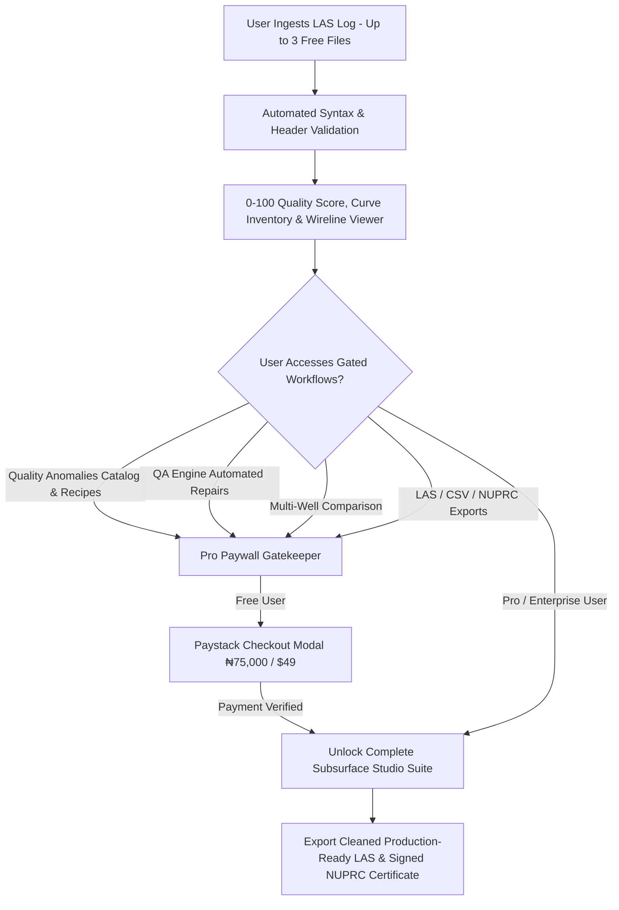
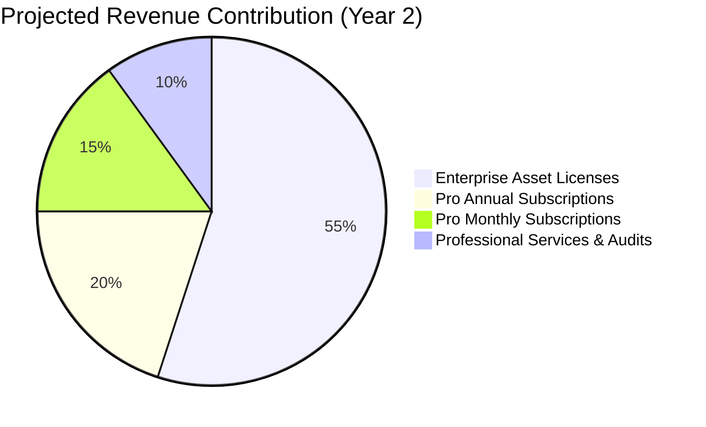
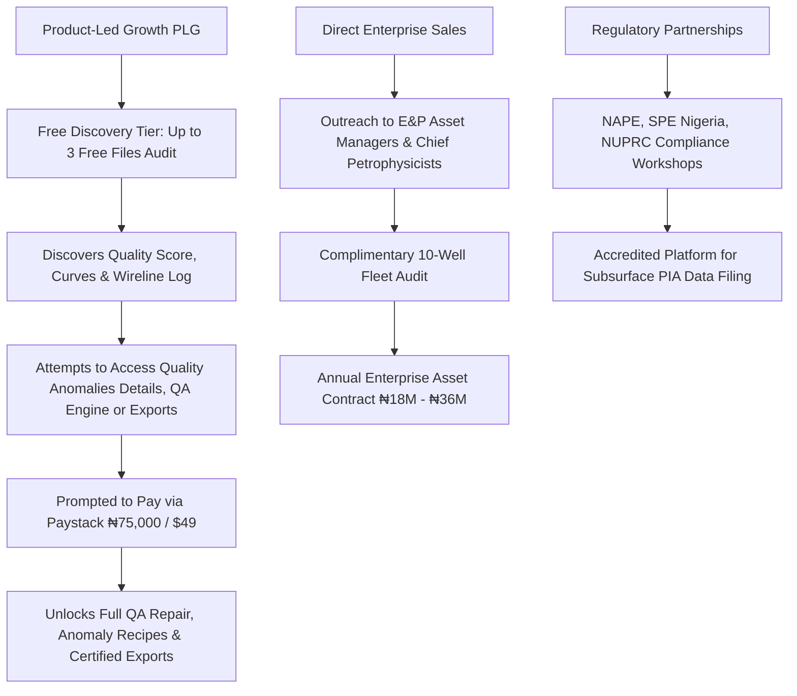
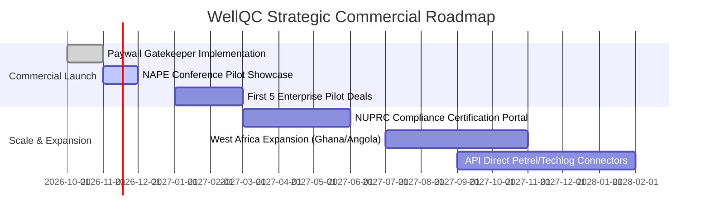

# WellQC™ Enterprise Business Plan & Commercial Proposal

> **Confidential Document | Version 2.5 | November 2026**  
> **Prepared by:** WellQC Executive & Commercial Strategy Team  
> **Target Audience:** Investors, Board of Directors, Upstream Energy Operators (E&P), and Regulatory Stakeholders (NUPRC, NNPCL)

---

## Executive Summary

**WellQC™** is a specialized, cloud-native petrophysical software-as-a-service (SaaS) platform engineered to solve the multi-billion-dollar data integrity crisis in upstream oil and gas exploration and production (E&P). 

Every year, oil and gas operators spend hundreds of millions of dollars drilling exploration and development wells. However, up to **35% of wireline log data** stored in Log ASCII Standard (CWLS LAS 2.0 / 3.0) format suffers from critical defects: corrupt headers, non-standard logging mnemonics, depth non-monotonicities, sensor flatlines, and silent data gaps. Consuming dirty well logs in reservoir modeling software (e.g., Petrel, Techlog, GeoGraphix) results in compromised petrophysical interpretations, miscalculated hydrocarbons in place, catastrophic drilling hazards, and costly dry holes.

WellQC eliminates this risk by delivering an automated, AI-driven quality assurance, standardisation, and repair pipeline:
1. **Automated Mnemonic Standardisation (API RP 66 compliant)** with fuzzy matching and custom alias dictionaries.
2. **Deterministic & AI Quality Scoring (0–100 Overall Score)** categorizing data into *Excellent*, *Good*, *Poor*, and *Critical* grades.
3. **Machine Learning Imputation Benchmark Engine** cross-validating KNN, Spline, and Tree regressors against ground truth.
4. **Interactive Multi-Curve Wireline Log Viewer** with calibrated petroleum scales (e.g., GR 0–150 GAPI, deep resistivity log scale) and dual view modes (Classic Paper Log and Dark Subsurface).
5. **Multi-Well Stratigraphic Correlation & Alignment Engine** calibrated to regional Niger Delta formations (Akata, Agbada, Benin).
6. **NUPRC-Compliant Digital Audit Certificates** ensuring full compliance with the Nigerian Upstream Petroleum Regulatory Commission under the Petroleum Industry Act (PIA 2021).

### The "Diagnosis is Free; Remediation is Monetized" Funnel
WellQC employs an ultra-high-converting **Product-Led Growth (PLG)** revenue model:
* **Free Discovery Tier (Up to 3 LAS Files):** New users can upload and audit up to **3 LAS files completely free**. They gain visibility into the well's headline health metrics: overall composite quality score (0–100), health grading (*Excellent*, *Good*, *Poor*, *Critical*), curve inventory (~CURVE count & null percentages), raw LAS syntax checks, and **full access to the Interactive Multi-Track Wireline Log Viewer & Telemetry HUD**.
* **Feature Gating on Free Tier:** To drive conversion, the platform strictly gates high-value remediation workflows behind WellQC Pro:
  1. **Detailed Quality Anomalies Diagnostics:** Specific anomaly descriptions, depth boundaries, severity scores, and automated remediation recipes are locked.
  2. **QA Engine Repair Studio:** Automated despiking, physical limit boundary clamping, duplicate depth resolution, and KNN/Spline ML null imputation are locked.
  3. **Multi-Well Stratigraphic Comparison:** Offset cross-correlation, dynamic lag depth shifts, and Niger Delta reservoir continuity verification are locked.
  4. **Certified Exports & Reports:** Production-ready LAS 2.0 file downloads, CSV data tables, JSON audit trails, and official NUPRC Form WQC-08-A digital certificates require Pro activation.
* **The Pro Upgrade Trigger:** When a user navigates to the Quality Anomalies remediation tab, QA Engine, Multi-Well Comparison, or attempts file exports, the platform presents the **Paystack Pro Payment Modal** (₦75,000 / $49 per month or ₦750,000 / $490 per year).

---

## 1. Company & Product Overview

### 1.1 Mission & Vision
* **Mission:** To eradicate petrophysical uncertainty by providing the global energy sector with the most accessible, automated, and mathematically rigorous well log quality assurance platform.
* **Vision:** To become the universal verification layer and regulatory standard for all subsurface wireline data across Africa and global frontier basins.

### 1.2 Core Value Proposition
| Stakeholder | Pain Point | WellQC Value Proposition |
|---|---|---|
| **Petrophysicists & Geoscientists** | Spend 30%–50% of time manually cleaning raw LAS files in spreadsheets or custom scripts. | Automated end-to-end audit, repair, and standardisation in under 3 seconds per log. |
| **Asset Managers & Chief Geologists** | Lack visibility into fleet-wide log quality; risk drilling multi-million-dollar dry holes. | Centralized Executive Command Center with fleet KPI telemetry, quality trending, and risk alerts. |
| **Drilling & Operations Engineers** | Experience rig downtime and casing misplacements from uncalibrated depth offsets. | Cross-well depth alignment, formation cutoff verification, and real-time offline PWA on remote rigs. |
| **Regulators (NUPRC, NNPCL)** | Receive disparate, unstandardised well archives from different operators. | Standardized, tamper-evident digital audit certificates with SHA-256 verification and automated PIA reporting. |

---

## 2. Market Problem & Opportunity

### 2.1 The Subsurface Data Crisis
In the petroleum industry, wireline logging represents the definitive truth of what lies thousands of meters beneath the earth's surface. However, the legacy Log ASCII Standard (LAS) format—created in 1989—lacks modern data constraints.
* **Mnemonic Chaos:** Different logging contractors (SLB, Baker Hughes, Halliburton, Weatherford) use proprietary mnemonics. A single Gamma Ray channel may appear as `GR`, `GAMMA`, `GRC`, `GAM`, `SGR`, or `ECGR`.
* **Silent Null & Boundary Violations:** Formation density (`RHOB`) recorded outside physical rock physics boundaries (e.g., `< 1.0` or `> 3.2 g/cc`) corrupts volumetric estimates of oil in place.
* **Depth Indexing Glitches:** Tool sticking causes duplicate depths and non-monotonic depth steps, throwing off structural cross-sections.
* **Regulatory Non-Compliance:** Non-compliant subsurface submissions trigger regulatory queries, license renewal delays, and compliance penalties under the Nigerian Petroleum Industry Act (PIA 2021).

### 2.2 Addressable Market Sizing (TAM, SAM, SOM)
* **Total Addressable Market (TAM) — \$4.6 Billion:** Global Subsurface Data Management, Petrophysical Analysis, and Log Quality Control Software Market.
* **Serviceable Addressable Market (SAM) — \$380 Million:** African and Middle Eastern upstream exploration, asset evaluation, and digital oilfield compliance markets.
* **Serviceable Obtainable Market (SOM) — \$42 Million:** Nigeria and Gulf of Guinea Independent Operators, IOC joint ventures, local petroleum consultancies, and national regulatory oversight bodies over a 36-month horizon.

---

## 3. Product & Technology Differentiation

WellQC combines high-performance web architecture with native petroleum engineering algorithms:

```mermaid
flowchart LR
    subgraph Frontend [Modern High-Fidelity UI]
        Next[Next.js 15 App Router]
        React[React 19 & TypeScript]
        Tailwind[Tailwind CSS & SF Pro Typography]
        PWA[Offline-First PWA Service Worker]
    end

    subgraph Backend [Petrophysical Compute Engine]
        FastAPI[FastAPI Python Microservice]
        NumPy[NumPy & Pandas Stack]
        SciKit[Scikit-Learn ML Imputation Engine]
        Lasio[Lasio Engine]
    end

    subgraph Storage [Secure Cloud Persistence]
        Neon[Neon Serverless PostgreSQL]
        Prisma[Prisma ORM]
        IndexedDB[Client-Side IndexedDB Workspace]
    end

    Frontend <--> Backend
    Frontend <--> Storage
    Backend <--> Storage
```

### 3.1 Key Architectural Pillars
1. **Next.js 15 + FastAPI Dual Engine:** Ultra-fast client-side rendering for log track manipulation paired with a Python microservice executing scientific linear algebra, KNN imputation, and correlation math.
2. **Automated Mnemonic Standardisation:** Over 40+ built-in aliases covering GR, RT, RHOB, NPHI, DT, CALI, SP, and PEF, with custom alias registration saved persistently per enterprise tenant.
3. **Calibrated Petrophysical Visualization:** Full support for classic borehole paper styling and modern dark subsurface aesthetics; interactive zoom, synchronized depth scrolling, and standard scale limits (e.g., GR 0–150 GAPI).
4. **Machine Learning Imputation Suite:** Ground-truth masking cross-validation benchmarking KNN, Cubic Spline, Mean, and Linear methods to guarantee data integrity before machine learning ingestion.
5. **Cross-Well Correlation Engine:** Pearson correlation coefficient ($r$), optimal lag depth shift computation, and stratigraphic matching against Niger Delta Akata, Agbada, and Benin formations.
6. **Offline Rig PWA Capability (Universal for All Users):** The installable Progressive Web App (PWA) workstation is open to all users across every tier (Free, Pro, and Enterprise). Service workers and client-side IndexedDB caching allow field petrophysicists, students, and consultants on offshore rigs or swamp locations with intermittent satellite connectivity to run local validations and view cached assets with zero network dependency.

---

## 4. Business Proposal & Engagement Framework

For exploration companies, asset teams, and regulatory agencies evaluating WellQC, the platform offers three streamlined commercial engagement models:

### 4.1 Deployment Options
* **Multi-Tenant Secure Cloud SaaS:** Deployed on enterprise cloud infrastructure with Neon Serverless Postgres. Zero IT footprint, instant onboarding, automated updates, and regional Paystack billing.
* **Dedicated Virtual Private Cloud (VPC):** Single-tenant isolation inside AWS, Microsoft Azure, or Google Cloud Platform, connecting directly to corporate Petrel and Techlog object storage buckets.
* **Enterprise On-Premise Appliance:** Air-gapped deployment for IOCs and national regulators with stringent data sovereignty and strict internal cybersecurity restrictions.

### 4.2 Security, Data Privacy & Governance
* **Data Sovereignty & Confidentiality:** Every uploaded well log is sandboxed with strict multi-tenant tenant isolation (`ownerId`). Well data is never shared across organizations or used to train public machine learning models.
* **NDA Gatekeeper Enforcement:** Enforced in-platform non-disclosure agreement acceptance prior to accessing data ingestion modules.
* **Encryption Standards:** All wireline data is encrypted in transit via TLS 1.3 and at rest via AES-256.
* **Immutable Audit Trail:** Every log modification, anomaly repair, threshold override, and export is recorded in an immutable audit ledger compliant with NUPRC governance guidelines.

### 4.3 Service Level Agreements (SLAs)
* **Cloud Platform Uptime:** 99.9% availability commitment.
* **Support Response Times:**
  * Free/Pro Users: 24-hour turnaround via email.
  * Enterprise Clients: Dedicated Technical Account Manager with 2-hour priority incident response and 24/7 emergency hotline.

---

## 5. Comprehensive Revenue Model

WellQC employs a diversified, multi-tiered monetization strategy tailored to the purchasing behaviors of petroleum engineers, independent operators, and major energy corporations.

### 5.1 Commercial Tiers & Pricing Matrix

| Tier | Target Customer | Pricing (NGN) | Pricing (USD) | Key Entitlements & Paywall Boundary |
|---|---|---|---|---|
| **Free Discovery Tier** | Students, independent consultants, rig interns evaluating well data | **₦0** (Free) | **$0** (Free) | **Up to 3 free LAS files.** Automated parsing, 0–100 QA score, curve inventory, raw header verification, **Interactive Multi-Track Wireline Log Viewer & Telemetry HUD**, and **Universal Installable PWA Workstation (Offline Rig Mode for all users)**. **Gated Paywall Boundary:** Quality Anomalies details & remediation recipes, QA Engine automated repair, Multi-Well comparison, and certified exports require WellQC Pro. |
| **Pro Monthly** | Active freelance petrophysicists, small consultancies | **₦75,000** / month | **$49** / month | **Complete Subsurface Studio Unlocked.** Unlimited LAS uploads, full multi-track wireline log viewer, detailed anomaly diagnostics, automated QA repairs (despiking, clamping, duplicate depth resolution, KNN/Spline null imputation), standardisation dictionary, closed-loop QA database persistence, multi-well correlation, and uncapped CSV/LAS/NUPRC Form WQC-08-A exports. |
| **Pro Annual** | Mid-size consultancies, dedicated G&G teams | **₦750,000** / year *(2 months free)* | **$490** / year | All Pro features + priority ML imputation benchmarks, batch queue processing, offline PWA rig mode, cleaned LAS export downloads, priority email support. |
| **Enterprise Asset License** | Independent E&P Operators, Marginal Field Holders | **₦18,000,000 – ₦36,000,000** / year | **$15,000 – $30,000** / year | Up to 25 seats, unlimited well log assets, Multi-Well Stratigraphic Correlation Engine, NUPRC Digital Signature suite, custom API keys, webhooks, dedicated account manager. |
| **Enterprise Sovereign / Regulator** | National Oil Companies (NNPCL), Regulators (NUPRC) | **Custom Quote** (From ₦60,000,000 / year) | **Custom Quote** (From $50,000 / year) | Unlimited seats, dedicated on-prem/VPC instance, custom basin formation cutoffs, centralized operator compliance audit dashboard. |

### 5.2 The Pro Paywall Conversion Mechanics
1. **Zero-Friction Ingestion:** User drags in up to 3 LAS well logs on the `/upload` workspace without submitting payment details. Once ingested, well assets cannot be deleted by standard users (only system administrators retain deletion authority), preventing quota evasion through deletion/re-upload cycles while preserving immutable subsurface compliance records.
2. **Transparent Health Discovery:** The platform calculates the composite Well Quality Score (e.g. 52/100, POOR), displays curve summaries, renders the interactive wireline log curves with real-time telemetry, and indicates the presence of critical anomalies.
3. **The Gated Experience:** When the petrophysicist attempts to:
   * Inspect detailed quality anomalies and specific depth ranges,
   * Launch automated cleaning in the QA Engine,
   * Run multi-well correlation comparisons, or
   * Export cleaned LAS files / NUPRC certificates,
   the application presents the **Paystack Pro Payment Modal**:
   * *Headline:* "Unlock WellQC Pro Subsurface Studio"
   * *Value Proposition:* "Access detailed anomaly remediation recipes, automated despiking, KNN/Spline null imputation, multi-well correlation, and official NUPRC compliance certificates."
   * *Plan Options:* ₦75,000/mo ($49/mo) or ₦750,000/yr ($490/yr).
   * *Payment Rails:* Instant automated checkout via Debit Cards, Bank Transfer, USSD, and Mobile Money.
4. **Immediate Fulfillment:** Upon successful transaction verification via Paystack webhook, `User.tier` transitions to `PRO`, immediately granting full access across all platform workspaces.

### 5.3 Ancillary Revenue Streams
1. **Professional Integration Services:** Custom integration into enterprise legacy databases, custom logging tool mnemonic mapping, and historical archive batch remediation (**₦5,000,000 – ₦15,000,000** per engagement).
2. **NUPRC Regulatory Fast-Track Audits:** Official third-party well log certification service for marginal field license renewals and farm-in asset evaluations (**₦1,500,000** per well package).
3. **Paystack Localized Payment Infrastructure:** Frictionless payments via Nigerian Naira debit cards (Verve, Mastercard, Visa), Direct Bank Transfer, USSD, and Apple Pay, alongside USD international processing.

---

## 6. Three-Year Financial Forecast

### 6.1 Key Growth Metrics & Assumptions
* **Customer Acquisition:** Focus initially on Nigeria’s ~40 active independent E&P operators, ~100 subsurface consultancies, and IOC joint ventures, before expanding across West Africa (Ghana, Equatorial Guinea, Angola).
* **Conversion Rate:** The "Diagnosis is Free, Remediation is Paid" funnel is projected to achieve a **14% free-to-paid conversion rate**, significantly higher than generic B2B SaaS (typical 3%–5%), because users only hit the paywall *after* seeing concrete proof of severe data corruption in their own proprietary files.
* **Churn Rate:** Projected at `< 5%` annually for Enterprise licenses due to high switching costs and integration depth.
* **Gross Margins:** Exceeds **82%**, driven by low cloud compute costs and automated serverless architecture.

### 6.2 Pro-Forma Income Statement (FY 2026 – FY 2028)

| Metric (in USD thousands) | Year 1 (FY 2026) | Year 2 (FY 2027) | Year 3 (FY 2028) |
|---|---|---|---|
| **Active Pro Subscribers (Avg)** | 85 | 240 | 600 |
| **Enterprise Operating Licenses** | 4 | 14 | 36 |
| **Professional Audit Contracts** | 6 | 18 | 32 |
| **Gross Revenue — Pro SaaS** | \$41.6K | \$117.6K | \$294.0K |
| **Gross Revenue — Enterprise Licenses** | \$80.0K | \$350.0K | \$990.0K |
| **Gross Revenue — Services & Audits** | \$30.0K | \$108.0K | \$224.0K |
| **Total Gross Revenue** | **\$151.6K** | **\$575.6K** | **\$1,508.0K** |
| *Cost of Goods Sold (Hosting, DB, Paystack fees)* | (\$24.2K) | (\$74.8K) | (\$180.9K) |
| **Gross Profit** | **\$127.4K** *(84.0%)* | **\$500.8K** *(87.0%)* | **\$1,327.1K** *(88.0%)* |
| Operating Expenses (R&D, Engineering) | (\$65.0K) | (\$160.0K) | (\$320.0K) |
| Sales, Marketing & Oilfield Conferences | (\$35.0K) | (\$110.0K) | (\$240.0K) |
| General, Administrative & Compliance | (\$18.0K) | (\$45.0K) | (\$95.0K) |
| **EBITDA** | **\$9.4K** | **\$185.8K** | **\$672.1K** |
| **Net Margin %** | **6.2%** | **32.3%** | **44.6%** |

---

## 7. Go-To-Market (GTM) & Sales Strategy

### 7.1 Direct B2B Enterprise Sales
Targeting Chief Operating Officers, Exploration Managers, and Chief Petrophysicists across key indigenous operators (e.g., Seplat Energy, Oando, First E&P, Waltersmith, ND Western, Aradel Holdings).
* Offer a complimentary **"10-Well Legacy Archive Health Audit"** demonstrating real-world anomalies, flatline sensors, and hidden gaps in their historical assets.
* Convert successful audit findings into annual Enterprise Asset Licenses.

### 7.2 Product-Led Growth (PLG) & Conversion Mechanics
* **Frictionless Freemium Entry:** Petrophysicists test WellQC immediately without credit cards by dragging in any 3 LAS files.
* **Value Revelation:** Users visually confirm sensor flatlines, depth inversions, and missing curves in their proprietary logs.
* **High-Intent Paywall:** Attempting to clean the data routes directly to the payment portal, converting urgent user pain into predictable SaaS revenue.

### 7.3 Strategic Alliances & Institutional Endorsements
* **NAPE (Nigerian Association of Petroleum Explorationists):** Official technical paper presentations, booth sponsorships, and workshops during the annual international conference.
* **SPE (Society of Petroleum Engineers Nigeria Council):** Petrophysical training webinars for young professionals and continuous professional development (CPD) certification.
* **NUPRC Alignment:** Presenting WellQC as the turn-key software standard for operators submitting data to the National Data Repository (NDR).

---

## 8. Risk Management & Mitigation Matrix

| Risk Factor | Severity | Probability | Mitigation Strategy |
|---|---|---|---|
| **Data Security & Intellectual Property Concerns** | High | Medium | Strict zero-training policy; well logs are client-isolated with AES-256 encryption. Provide VPC and air-gapped on-premise options for IOCs. |
| **Currency Devaluation (NGN Volatility)** | Medium | High | Dual currency pricing architecture (Paystack supports both NGN and USD). Infrastructure costs indexed in USD, enterprise contracts pegged to USD equivalent. |
| **Long Enterprise Procurement Cycles** | High | High | Freemium-to-Pro funnel generates immediate self-serve cash flow while enterprise deals undergo 3–6 month vendor review. |
| **Resistance to Cloud Tools on Rigs** | Medium | Medium | Implemented Progressive Web App (PWA) architecture enabling offline processing on offshore rigs and remote swamp locations. |

---

## 9. Implementation Roadmap & Milestones

1. **Q4 2026:** Full self-serve Paystack portal operational with QA Engine remediation paywall; pilot case studies presented at Nigerian petroleum exploration forums.
2. **Q1 2027:** Secure 5 commercial Enterprise Asset pilot contracts across independent Niger Delta operators.
3. **Q2 2027:** Formal integration with NUPRC National Data Repository data submission standards.
4. **Q3–Q4 2027:** Regional expansion into Gulf of Guinea markets (Ghana, Equatorial Guinea, Gabon) and launch of direct cloud connectors for SLB Petrel and Techlog.

---

## Conclusion & Next Steps

WellQC transforms raw, unverified well logs into calibrated, production-ready petrophysical assets in seconds. By letting users discover data corruption for free on up to 2 files and gating automated remediation behind a streamlined Paystack paywall, WellQC establishes a highly profitable, self-funding acquisition engine alongside high-ticket enterprise E&P licensing contracts.
